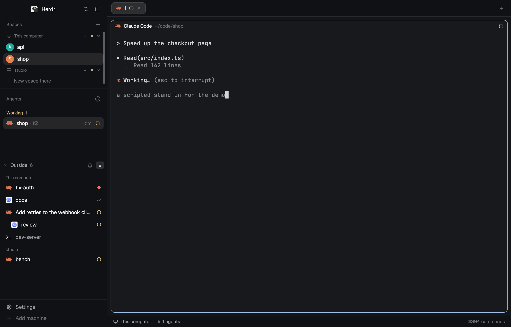

# herdr-outside

[](https://github.com/jeffarese/herdr-outside/actions/workflows/ci.yml)

A mod for the [Herdr](https://herdr.dev) desktop app: the agents and terminals
[herdr-core](https://github.com/herdrdev/herdr-core) (`hc`) runs outside your spaces, listed in
the window.


Herdr shows a terminal when it belongs to a space. An agent started another way, with `hc run`
in a shell, by a script or by another tool, runs in the same herdr-core but appears nowhere in
the window: the Agents list leaves it out, and you find it only with `hc ls`. This mod lists
those agents with their live status, and tells you when one needs you or finishes. A click
peeks at one, and a button gives it a tab in the space you are in.

This is an unofficial mod. It is not affiliated with Herdr.

## Install

Ask your agent, in a terminal inside Herdr:

> Add the Herdr mod at github.com/jeffarese/herdr-outside

Or run the installer:

```sh
curl -fsSL https://raw.githubusercontent.com/jeffarese/herdr-outside/main/install.sh | sh
```

It copies `mods/outside` into `~/.config/herdr-app/mods` and opens the Outside window. Run it
again to update. From a clone, `./install.sh` does the same, and `./install.sh --remove` takes
the mod out.

It needs the Herdr app (tested with 0.1.15) and herdr-core (tested with 0.1.19). The mod reads
the list of terminals the app already has. It runs no programs and makes no network requests.

## Using it

| To | Do |
| --- | --- |
| See what runs outside your spaces | Look at the Outside window. It stays open and comes back when Herdr starts. |
| Look at an agent | Click its row. Herdr peeks at it over the tab; the peek can keep it as a tab. |
| Bring an agent into the space you are in | Hover its row and click the tab button. It gets a tab and leaves the list. |
| Put an agent in another space | Right-click its row and pick the space. Herdr shows that space, with the agent in a new tab. |
| List shells and scripts too | Click the filter button in the header. Click again for agents only. |
| Stop the notifications | Click the bell in the header. Click again to turn them back on. |
| Move the window | Drag it by its header. It stays where you drop it. |
| Close the window | Click its ×, or run `herdr-app do mod.open --name outside`. |
| Open it again | `herdr-app do mod.open --name outside` |

Herdr tells you when an agent in a space needs you or finishes, but not about agents outside.
While the panel is open, it does: a notification that peeks at the agent when clicked, and the
same sound Herdr plays, if your sounds are on.

Each row shows the program's icon, a name and the status:

| Mark | Status |
| --- | --- |
| Red dot | Needs you: the agent is waiting on a permission or a question |
| Check mark | Done |
| Turning ring | Working |
| Small grey dot | Idle |
| Nothing | A program that reports no status, such as a shell or a script |

The name is the one the terminal was started with (`hc run --name`). Without one, it is what the
agent says it is working on, and failing that the program. The agents that need you come first.
A sub-agent is listed under the agent that started it. When agents on more than one machine
are listed, each machine's agents are grouped under its name, this computer first.

To open and close the window with a key, add a binding to `~/.config/herdr-app/keys.json`, under
`global`:

```json
"ctrl-shift-u": "mod.open:outside"
```

Editing `keys.json` makes the whole file yours: Herdr then stops adding new default shortcuts
to it.

## In the sidebar

Herdr's own layouts are read-only, so the mod can't add itself to their sidebar. In a layout of
your own it can be a block like any other:



1. Copy the layout: `herdr-app do layout.clone '{"name":"main","as":"my-main"}'`
2. In `~/.config/herdr-app/layouts/my-main.json`, add this block to the children of
   `sidebar-lists`:

   ```json
   { "id": "outside", "type": "block", "size": { "weight": 1 }, "content": { "mod": "outside" } }
   ```

A copied layout no longer gets Herdr's updates to the original. In a sidebar narrower than
160 px the panel becomes a rail of icons, like Herdr's own panels.

`"content": { "mod": "outside", "props": { "show": "all" } }` starts the block with shells and
scripts listed. The filter button's last setting wins once you have used it.

## What counts as outside

A terminal is listed when all of these hold:

- **It is running.** Finished terminals stay out.
- **It has no place in the window:** no pane, and no `herdr.space` label.
- **Nothing above it has a place either.** A sub-agent of an agent in a space belongs to that
  agent's tab, and the Agents list already shows it there.
- **Herdr lists its machine.** Machines added with `hc machine add --temp`, such as an agent's
  short-lived sandbox, stay out.

With the filter on agents, a row is kept when it or something it started is an agent: a coding
agent Herdr knows, or any program that reports a status.

## Known limits

- **Other machines:** an agent on another machine can be peeked at from anywhere, but it gets a
  tab only in a space on its own machine. The tab button shows only then, and the right-click
  menu lists only that machine's spaces.
- **No drag and drop:** an agent goes to a space through the button or the menu.
- **Notifications need the panel:** a closed window notifies nothing.
- **No keyboard navigation:** the list is for the pointer.
- **Windows:** the installer is a shell script. On Windows, copy `mods/outside` into the app's
  `mods` folder by hand. The mod itself is untested there and on Linux.
- **Ending an agent:** the mod has no button for it. Use `hc kill <address>`; the address is in
  the row's tooltip.

## Development

```sh
npm test                                      # the selection logic, with node --test
herdr-app check ~/.config/herdr-app/mods/outside
sh docs/demo/record.sh                        # the pictures, on a synthetic stage
```

- **`mods/outside/pick.js`** decides which terminals are outside and in what order. It imports
  nothing from the app, so Node can test it.
- **`mods/outside/main.js`** draws the panel with the app's `herdr` and `gpui-kit` modules.
- **[RECIPE.md](RECIPE.md)** is the brief an agent can rebuild the mod from.
- **[docs/demo](docs/demo)** builds the stage the pictures were taken on. Nothing in them is real.

## License

[MIT](LICENSE)
