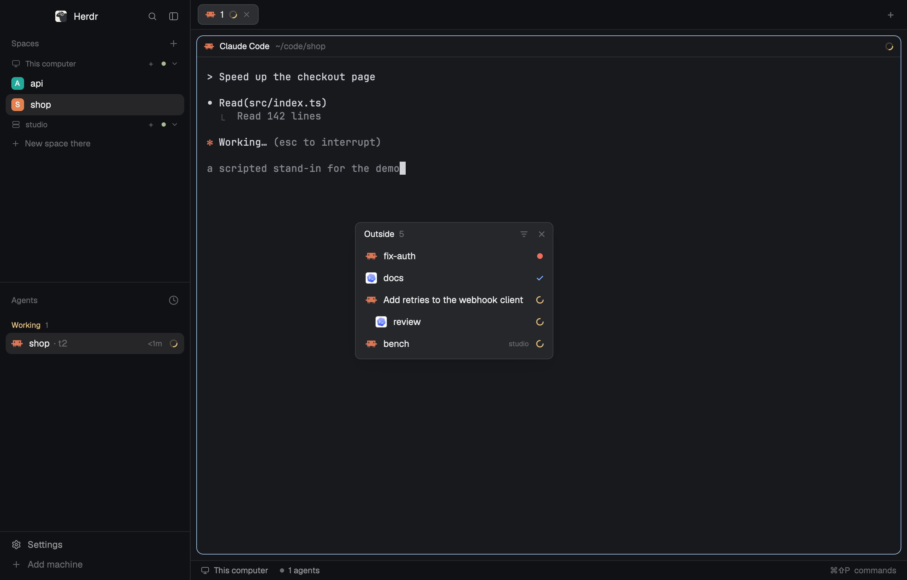

# Outside

A list of the agents and terminals herdr-core runs that have no place in Herdr's window: ones
started with `hc run` in a shell, by a script or by another tool. Each row shows the program,
a name and the live status. A click peeks at the terminal, and a button on the hovered row
gives it a tab in the shown space. When one of them starts waiting on the person or finishes,
the mod posts a notification.

## What you see

One mod, `outside`, drawn in one of two ways.

**As a window** (what `mod.open {name: "outside"}` leads to): 280 px wide, as tall as its list,
which scrolls beyond 12 rows. Herdr draws the frame.

- **Header**, 32 px: "Outside" in `foreground`, 12 px; the row count in `dim`; then, at the
  right, a bell button, a filter button and a close button, each a 13 px icon in `dim` with 3 px padding and a
  4 px radius.
- **Rows**, 30 px each, 1 px apart, 8 px radius, text 13 px, left to right:
  - the program's icon from the app's table, 16 px (`svg` tinted `foreground` when
    `program.tint`, else `image`);
  - the name, truncated, in `foreground`; in `muted` when the status is idle or there is none;
  - the machine's name, 10 px in `dim`, for a terminal on another machine;
  - the status mark, 12 px wide.
- A sub-agent's row is indented 14 px per level under the terminal that started it.
- **Empty**: one 12 px line in `dim`: "No agents outside your spaces. One started with hc run
  shows up here." With the filter on everything: "Nothing runs outside your spaces."

**As a block** in a layout: it fills the block on the `chrome` color. The header gains a 12 px
chevron at the left, and a click on the header folds the list. The close button is gone.
Narrower than 160 px it is a rail: one 18 px icon per top-level row, centered, 6 px apart, with
a 7 px dot on its top right corner in `blocked`, `done` or `working`.

## How it behaves

- **Statuses:** working is a 12 px arc in `working` that turns once every 900 ms; blocked is an
  8 px dot in `blocked`; done is a 12 px check in `done`; idle is a 6 px dot in `idle`; a
  program that reports no status has no mark. A status of `error` counts as blocked.
- **Order:** top-level rows by the most urgent status in their tree (blocked, done, working,
  idle, none), then oldest first. Each is followed by the terminals it started.
- **Name:** the terminal's `name`; else the title it reports; else its terminal title, without
  leading symbols; else its template; else the program's name for an agent or the basename of
  `argv[0]` for anything else; else the address.
- **Click a row:** `terminal.peek`.
- **Hover a row:** it takes the `hover` color and shows a tab button before the status mark.
  The button runs `terminal.keep`, which gives the terminal a tab in the shown space; the row
  then leaves the list. The button shows only when the shown space is on the terminal's machine.
- **Right-click a row:** a popup at the pointer, 220 px wide, titled "Add to space" (11 px,
  `dim`), listing the spaces on the terminal's machine, 28 px a row, the shown one marked
  "shown"; it scrolls beyond 8. A click runs `space.select` then `terminal.keep` and closes the
  popup. Without a space there: "No space on <machine> yet."
- **Tooltip on a row:** the status in words, the address and the folder.
- **Filter button:** switches between agents only (the default) and every terminal. It is
  drawn in `foreground` on `raised` while everything shows. The choice is kept in
  `localStorage`; until it is made, the block's `show` prop (`"all"` or `"agents"`) decides.
- **Notifications:** when a listed terminal's status changes to blocked or done, the mod posts
  `notify` with the title "<name> needs you" (level `warning`, body: the agent's question) or
  "<name> finished" (level `success`), an action that runs `terminal.peek`, and plays the
  `blocked` or `done` sound unless `settings().sounds.enabled` is false. A terminal seen for
  the first time posts nothing. The bell button turns this off and on (a crossed bell when
  off); the choice is kept in `localStorage`.
- **Window:** a press on the header drags it. It remembers where it was dropped and reopens on
  the next start. The close button closes it, and so does `mod.open` while it is open: the
  command toggles. `outside.close` closes it too.

## Built from

- `mods/outside/mod.json`: `{ "place": "left", "size": 240, "title": "Outside" }`.
- `mods/outside/pick.js`: pure functions, no app imports. `outside(all, { placed, machines,
  show })` returns `[{ terminal, depth }]`; `news(rows, before)` returns the rows that became
  blocked or done since the last call; `labelOf`, `statusOf`, `isAgent`, `machineOf`.
  A terminal is outside when its `state` is `"live"`, it has no `herdr.space` label, its
  address is not in `placed`, no ancestor through `parent` has a place, and its machine is in
  `machines`. With `show: "agents"`, a tree is kept when any row in it is an agent
  (`program.agent`, `reported`, or a status).
- `mods/outside/main.js`: the view. From `herdr`: `terminals()`, `panes()` (the placed
  addresses), `machines()` (the known machines), `spaces()` and `focused()` (the shown space's
  machine), `theme()`, `props()`, `settings()`, `run()`, `notify()`, `playSound()`,
  `openOverlay()`, `closeOverlay()`, `nextCommand()`.
- Commands: `terminal.peek {terminal}`, `terminal.keep {terminal}`, `space.select {id}`.
- The menu is the same mod, opened with `openOverlay({ mod: "outside", kind: "popup", at:
  { x, y }, width: 220, props: { menu: address } })`, `at` from the press's `position`.
- The window: `mod.open` shows a mod as a dialog. In `init`, a copy that has `props().overlay`
  but not `props().window` opens `openOverlay({ mod: "outside", kind: "window", key:
  "outside-window", keep: true, width: 280, props: { window: true } })`, or closes the window
  if one is open, then closes its own overlay and renders nothing. The window's copy keeps its
  overlay id in a module-level variable, which every copy shares, and clears it in `close()`.
- Art, all 16×16 one-color SVGs in the mod's folder: `spinner` (an open arc), `check`, `tab`
  (a rounded rectangle with a plus), `filter` (three shortening lines), `close`, `chevron`,
  `chevron-right`, `bell`, `bell-off`.
- No `exec`, no `hc`, no network, no timers: the app re-renders the mod when its data changes.
  The last status of each listed terminal is kept in a module-level Map, so a window and a
  sidebar block post one notification between them.

## Watch out

- `mod.open` calls its dialog by the mod's name. A window whose `key` is that name too collides
  with it: the dialog's `closeOverlay` can then close the window instead and leave an empty
  overlay behind. Give the window another key.

- Herdr's own layouts are read-only, so `"place": "left"` docks nothing in them. The window is
  what makes the mod usable without a copied layout.
- In a window, a press that reaches Herdr drags the window. Every row and button stops its own
  left press with `on_mouse_down("left", (_e, cx) => cx.stop_propagation())`.
- A dialog sizes to its content: a list with `flex_1` and `min_h(0)` collapses to nothing
  there. The window's list uses `max_h` instead.
- A popup is as tall as its content, like a dialog: give the menu's list `max_h`, not `flex_1`.
- `terminal.keep` fails with "A terminal's pane must stay on its own machine" when the shown
  space is on another machine, hence the rule for the tab button.
- A sub-agent of an agent that has a pane must stay out: the Agents list shows it under its
  parent. Walk up `parent` and guard against a loop.
- `terminals()` lists other machines' terminals with a `machine/` prefix on the address. Keep
  only machines in `machines()`, which leaves out `--temp` ones.
- Measure the block with `on_size_change` on the root, not with the layout's `sidebar` node:
  the block may sit anywhere.
- Animate the working mark with `.spin(900)`, never with a timer.

## Done when

- `herdr-app check mods/outside` passes.
- `hc run --bg -- claude` in a shell adds a row within a second, and the Agents list does not
  show that agent.
- A row's status mark follows the agent: working, blocked, done.
- An agent started from inside another outside agent is listed under it, indented.
- A click on a row opens a peek of that terminal.
- The tab button gives the terminal a tab in the shown space, and its row leaves the list.
- A right-click on a row lists the spaces, and a click on one moves the terminal into a new
  tab there and shows that space.
- The filter button adds a plain `hc run --bg -- sh` terminal to the list and removes it again.
- `herdr-app do mod.open --name outside` opens the window, the same command closes it, and an
  open window is there again after Herdr restarts.
- An outside agent that becomes blocked posts "<name> needs you" with its question, and a click
  on the notification peeks at it. With the bell off, nothing is posted.
- As a block in a copied layout's sidebar, the panel fills its block, and at 76 px wide it
  shows icons only.
